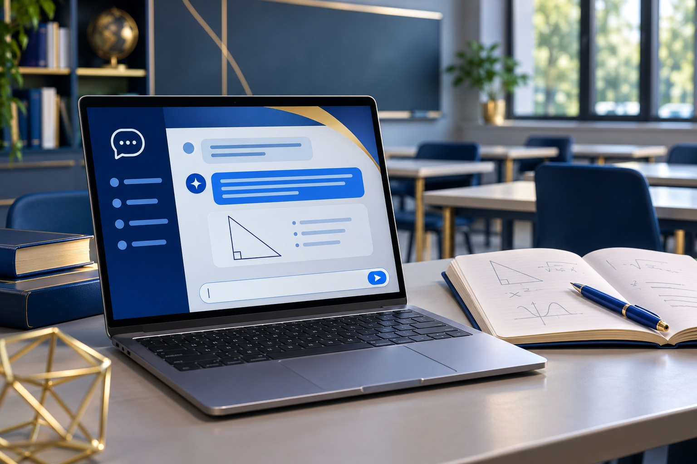
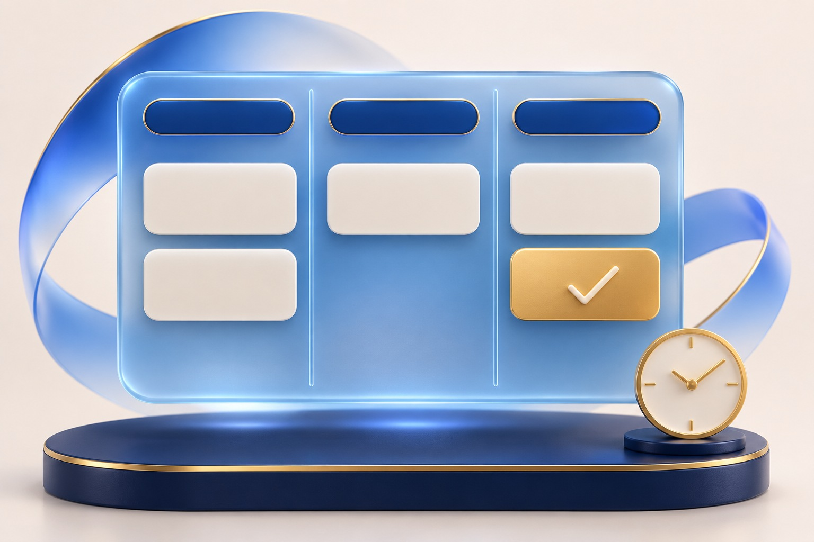
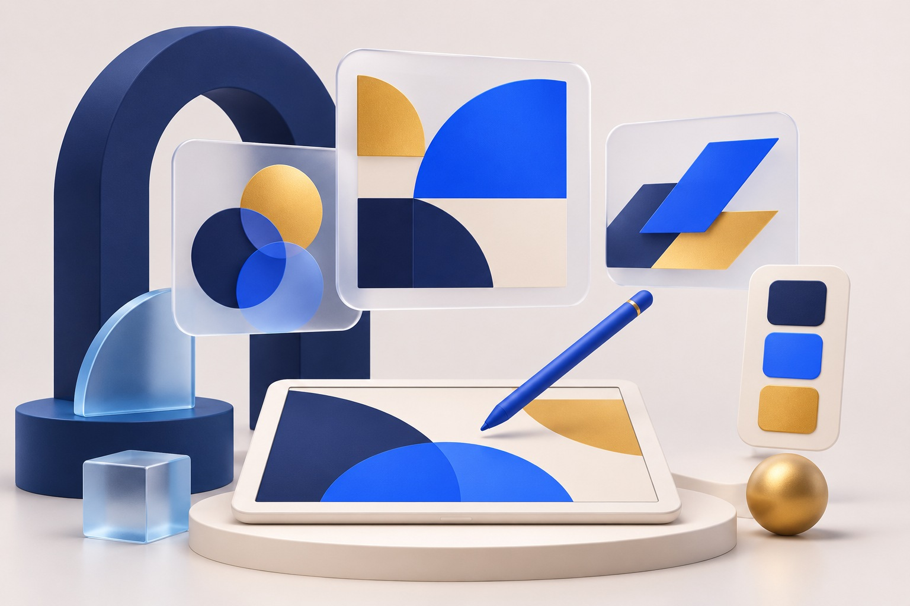
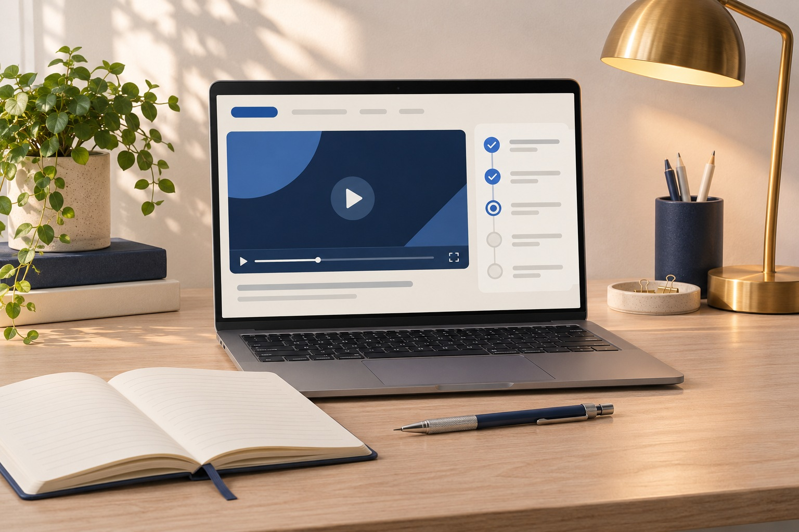
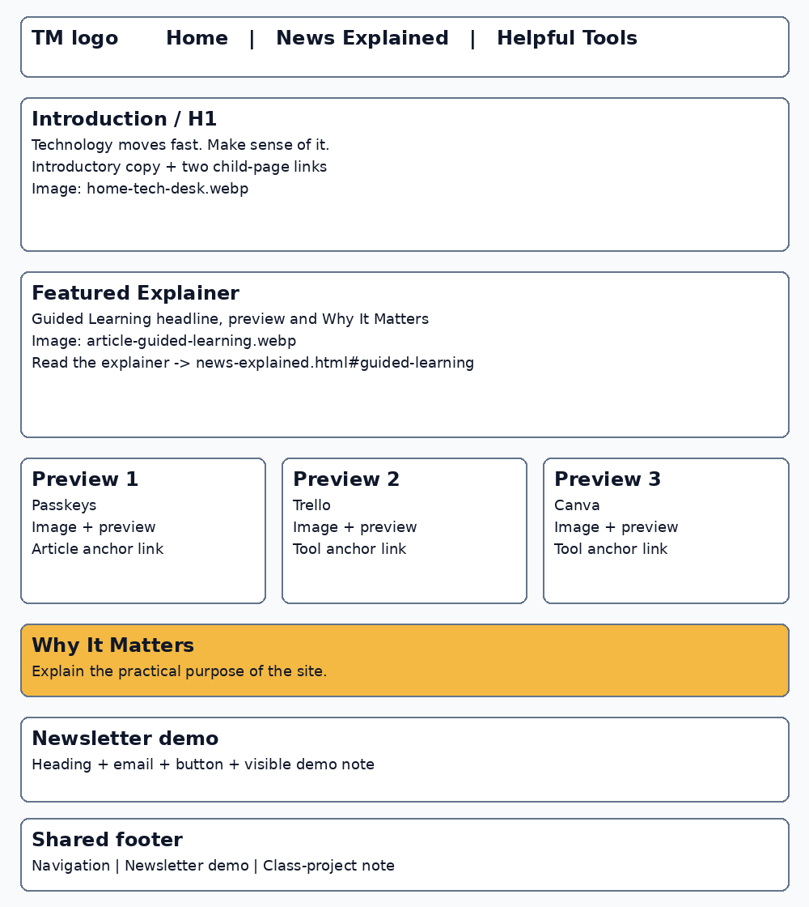
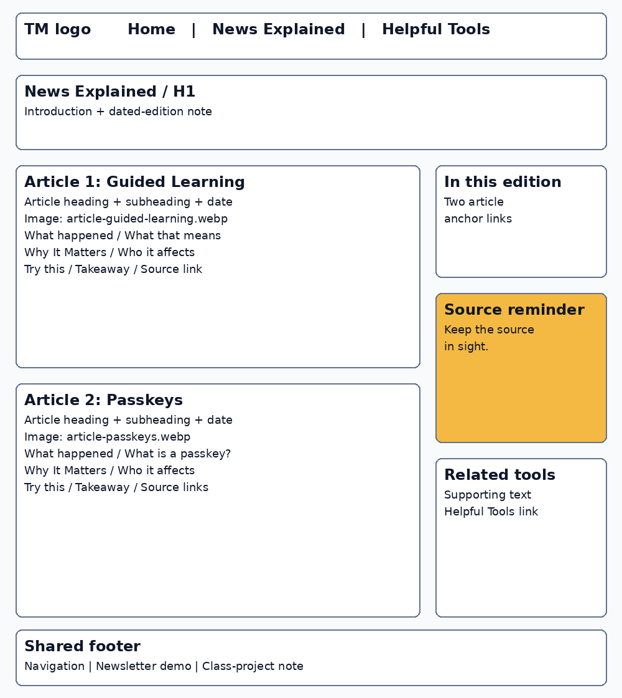
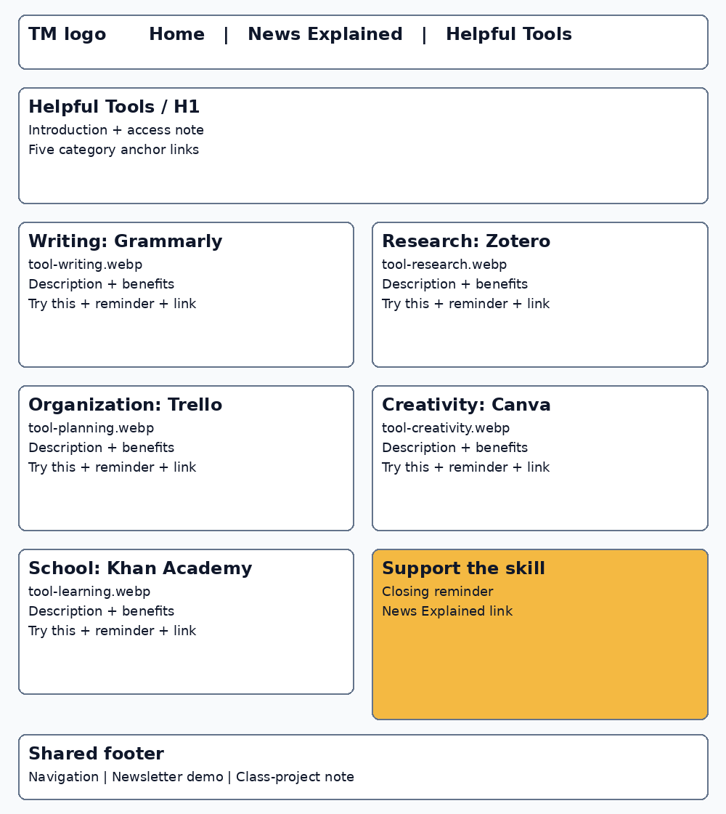

# Technology Made Simple - Complete Site Plan

AJ Jex | WDD 130 | November 18, 2026

Complete Personal Site Plan

AJ Jex | WDD 130 | November 18, 2026

### Overview

**Purpose:** Technology Made Simple explains important technology and AI developments in clear language, then shows readers why they matter and how to use related tools thoughtfully. The site helps students, beginners, and everyday users make informed choices without needing a technical background.

**Audience:** Students, beginners, and everyday technology users who want useful explanations, practical examples, and approachable tools without technical jargon.

**Website scope:** Exactly three website pages: Home, News Explained, and Helpful Tools. Articles are sections on News Explained; tool cards are sections on Helpful Tools.

**Hosting:** Publish the three-page static website using GitHub Pages. Use relative links so navigation also works within a project subdirectory.

### Branding and style guide

| Color | Hex | Use |
| --- | --- | --- |
| Midnight navy | #0F172A | Main headings, header and footer backgrounds |
| Electric blue | #2563EB | Links, buttons and featured accents |
| Warm gold | #F4B942 | Why It Matters backgrounds and highlights |
| Cool gray | #64748B | Secondary text on white |
| Off-white | #F8FAFC | Page backgrounds |

**Heading font:** Space Grotesk, Arial, sans-serif

**Paragraph font:** Inter, Arial, sans-serif

**Logo:** Use the supplied TM wordmark on a white or off-white header surface. Preserve its proportions. Use tm-icon.png for a compact mark and favicon.png for the browser icon.

**Visual direction:** Business and technology-news editorial style. Combine four photographic-style device and workspace images with four CGI illustrations. No people, faces, hands, portraits, or human silhouettes. All screen interfaces are illustrative concepts.

Use navy text on gold callouts, white text on blue buttons, and navy body text on off-white. Keep body copy at least 16 px on the website.

## Navigation and shared website text

| Page | File | Content |
| --- | --- | --- |
| Home | index.html | Introduction, feature, three previews, Why It Matters, newsletter demo |
| News Explained | news-explained.html | Two complete explainers and original source links |
| Helpful Tools | helpful-tools.html | Five tools, category links and responsible-use advice |

### Header - every page

**Brand:** Technology Made Simple

**Navigation:** Home | News Explained | Helpful Tools

**Logo link:** index.html

**Skip link:** Skip to main content

**Mobile menu labels:** Open navigation menu / Close navigation menu

Repeat all three navigation links in the header and footer on every page. Mark the current page visually and with aria-current="page". Keep both child-page links available even while visiting a child page.

### Footer - every page

**Tagline:** Clear explanations for a changing world.

**Copyright:** © 2026 Technology Made Simple. Created by AJ Jex for WDD 130.

**Project note:** Educational class project. Editorial images are AI-generated. Product names belong to their respective owners.

**Footer links:** Home; News Explained; Helpful Tools; Newsletter demo (index.html#newsletter)

**Back-to-top link:** Back to top

### Repeated content labels

Article sections: What happened; What that means / What is a passkey?; Why It Matters; Who it affects; Try this; Takeaway; Sources.

Tool-card labels: What it does; Who benefits; Try this; Use responsibly.

### Developer placement rules

All page copy, article headings, previews, and button labels remain selectable HTML text. Images contain supporting visuals only. Show each supplied caption below its image and use the alt text in the image register. Captions identify conceptual interfaces so generated artwork is not mistaken for a real product screenshot.

Each article and tool uses the matching section ID shown in this plan. All internal destinations stay within the three-page site. External source and product links go to the named provider. No extra About, article-detail, pricing, or contact pages are required.

## Page 1 - Home

**File:** index.html

**Browser title:** Technology Made Simple | Tech News & Useful Tools

**Meta description:** Understand technology and AI with plain-language explainers, practical tools, and clear reasons why each story matters.

### Introduction

**Eyebrow:** Clear news. Useful tools. Better understanding.

**H1:** Technology moves fast. Make sense of it.

Technology Made Simple explains technology and AI in everyday language. Understand what changed, why it matters, and what you can do with it, without sorting through technical jargon.

**Primary button:** Explore News Explained → news-explained.html

**Secondary button:** Find Helpful Tools → helpful-tools.html

home-tech-desk.webp | AI-generated editorial image; screen content is illustrative.

### Featured Explainer

**H2:** Google’s Guided Learning puts the focus on understanding

Google introduced a learning experience that asks questions and explains problems step by step. See what it does and how to keep your own thinking at the center.

**Why It Matters:** A useful study tool should give you another chance to practice. The real test is what you can explain after you close it.

**Button:** Read the explainer → news-explained.html#guided-learning

Featured-story image: article-guided-learning.webp, shown with the complete article on the News Explained content page below. Use the same file here.

## Page 1 - Home, continued

### More to explore

#### Everyday Technology | Passkeys explained: a different way to sign in

A fingerprint or PIN can approve a passkey sign-in. Learn what that means and why account recovery still matters.

**Link:** Understand passkeys → news-explained.html#passkeys

**Image:** article-passkeys.webp

#### Organization | Give your next project a clearer plan

Use Trello boards and cards to turn a large assignment into smaller tasks you can track.

**Link:** Explore organization tools → helpful-tools.html#trello

**Image:** tool-planning.webp

#### Creativity | Make your presentation easier to follow

Start with a clear message, then use Canva to organize the words and visuals that support it.

**Link:** Explore creative tools → helpful-tools.html#canva

**Image:** tool-creativity.webp

### Why It Matters

A technology headline is only useful when it connects to your life. Each explainer identifies the change, the people it affects, and a practical next step. Each tool card gives you a starting point and a reminder to use it thoughtfully.

### Newsletter demo

**Section ID:** newsletter

**Heading:** A clearer take on technology, once a week.

The planned Technology Made Simple newsletter brings together approachable explainers, useful tools, and one practical idea to try.

**Email field label:** Email address

**Placeholder:** you@example.com

**Button:** Try newsletter signup

**Visible note:** Class project demo: no email is stored and no subscription is created.

**Empty field error:** Enter your email address.

**Invalid email error:** Enter a valid email address, such as you@example.com.

**Success message:** Demo complete. Your email was not saved and no subscription was created.

Behavior: validate the email format in the browser. For valid input, prevent network submission, clear the field, and announce the demo success message. Do not save the address or imply a real subscription. No newsletter service or backend is needed.

## Page 2 - News Explained

**File:** news-explained.html

**Browser title:** News Explained | Technology Made Simple

**Meta description:** Read beginner-friendly explainers about AI learning tools and passkeys, with clear context, practical takeaways, and original sources.

**H1:** News Explained

Understand the change behind the headline. These explainers break down what happened, who it affects, and why it matters, with a practical next step and links to the original sources.

**Edition note:** Featured explainers: selected technology announcements from 2025, explained for everyday use.

### In this edition

**Jump link:** Google’s Guided Learning puts the focus on understanding → #guided-learning

**Jump link:** Passkeys explained: a different way to sign in → #passkeys

### Article 1 - Google’s Guided Learning puts the focus on understanding

**Section ID:** guided-learning

**Category:** AI & Learning

**Subheading:** Gemini’s learning feature uses questions and step-by-step explanations. Here’s how to approach it without handing over your thinking.

**Byline and date:** Technology Made Simple | November 18, 2026

Explainer based on Google’s August 6, 2025 announcement.

article-guided-learning.webp | AI-generated illustration; not an actual Gemini screenshot.

Full article text continues on the next document page; it remains one article section on the website.

## Page 2 - Article 1, full text

### Google’s Guided Learning puts the focus on understanding

#### What happened

Google introduced Guided Learning in Gemini on August 6, 2025. The company described an experience that asks questions, breaks problems into steps, and adapts explanations to the learner. It can also include diagrams, videos, and quizzes. The stated goal is to help people understand a subject rather than simply receive an answer. [S1]

#### What that means

Think of the difference between reading a worked example and explaining the next step yourself. A useful study conversation gives you room to attempt an answer, notice a mistake, and ask a follow-up question. Google’s announcement describes a tool built around that kind of interaction. It does not establish that every response will be correct or that every student will learn more. [S1]

#### Why It Matters

For students and beginners, the useful question is: Can I explain this without the tool? Treat an AI explanation as something to examine and practice, rather than something to copy into an assignment. The value comes from the thinking you do during and after the conversation.

#### Who it affects

Students reviewing difficult material, adults learning unfamiliar topics, and educators considering how AI might fit into practice activities. School rules and account access can differ, so check what your class allows before using an AI tool.

#### Try this

Choose one concept from your notes. Ask: “Give me one practice question. Let me try before you explain the answer.” Write your answer first, compare the explanation with your course materials, then attempt a new question without AI. If you still cannot explain the steps, return to your notes or ask your instructor.

**Takeaway:** Use AI to create another chance to practice, then check what you can do on your own.

#### Sources

[[S1] Google: Guided Learning in Gemini: From answers to understanding (August 6, 2025)](https://blog.google/products-and-platforms/products/education/guided-learning/)

## Page 2 - Article 2

**Section ID:** passkeys

**Category:** Everyday Technology

**H2:** Passkeys explained: a different way to sign in

Microsoft’s passwordless account announcement highlights a sign-in option worth understanding. Here’s what changes for everyday users.

**Byline and date:** Technology Made Simple | November 18, 2026

Explainer based on Microsoft’s May 1, 2025 announcement.

article-passkeys.webp | AI-generated concept illustration of passkey sign-in.

#### What happened

On May 1, 2025, Microsoft announced that new consumer Microsoft accounts would be passwordless by default, with several passwordless sign-in options. The announcement also described a sign-in experience that favors available passwordless methods and encourages passkey enrollment. It did not mean every existing account immediately lost its password. [S2]

#### What is a passkey?

A passkey is a digital sign-in credential for a particular website or app. You usually approve its use with the same kind of check used to unlock a device, such as a fingerprint or PIN. Passkeys can be stored through a supported provider or on a security key; some sync between devices while others stay on one device. [S3]

#### Why It Matters

Passkeys are designed to resist phishing, where a fake sign-in page tricks someone into giving away a password. They can also reduce the need to remember another password. That makes them useful to understand, even if you are not ready to change every account. They do not protect against every kind of online scam. [S3]

#### Who it affects

Anyone who encounters a passkey option while creating an account or signing in to a supported service. The available choices depend on the service, your device, and your passkey provider. [S3]

#### Try this

On a service you already use, open the official account settings and read its passkey instructions. Before making changes, find out where the passkey will be saved and how you would recover access after losing a device. Start with one account you understand, and follow the provider’s instructions rather than a link in an unexpected message.

**Takeaway:** A simpler sign-in still deserves a clear recovery plan.

Source links: [S2] Microsoft announcement; [S3] FIDO Alliance passkey guide. Full clickable links are listed on the sources page.

## Page 2 - Supporting text and links

### Keep the source in sight

Check the announcement date and open the original source before sharing a claim. An explainer helps you get oriented; the source gives you the original context.

### Put it into practice

Explore tools for writing, research, organization, creativity, and learning.

**Button:** Browse Helpful Tools → helpful-tools.html

### Article source links

[[S1] Google: Guided Learning in Gemini: From answers to understanding (August 6, 2025)](https://blog.google/products-and-platforms/products/education/guided-learning/)

[[S2] Microsoft: Pushing passkeys forward: Microsoft’s latest updates for simpler, safer sign-ins (May 1, 2025)](https://www.microsoft.com/en-us/security/blog/2025/05/01/pushing-passkeys-forward-microsofts-latest-updates-for-simpler-safer-sign-ins/)

[[S3] FIDO Alliance: Passkeys (Accessed November 18, 2026)](https://fidoalliance.org/passkeys/)

### Image and layout placement

Place article-guided-learning.webp above Article 1 and article-passkeys.webp above Article 2. Both articles appear in full on news-explained.html. The homepage feature and passkey preview link directly to their section IDs.

On desktop, use a readable main article column with a small right sidebar for In this edition, Keep the source in sight, and Put it into practice. On mobile, move the jump links above the articles and place the other sidebar content after both articles. Keep paragraph line lengths around 60-75 characters.

## Page 3 - Helpful Tools

**File:** helpful-tools.html

**Browser title:** Helpful Tools | Technology Made Simple

**Meta description:** Discover five approachable tools for writing, research, organization, creativity, and learning, with practical first steps and responsible-use reminders.

**H1:** Helpful Tools

Start with the task you want to do, then choose a tool that supports it. These five options cover writing, research, organization, creativity, and school or work. You do not need to learn them all at once.

These are starting points, not rankings. Features, access, and prices can change; check each provider’s website before signing up.

**Category link heading:** Jump to a category

**Writing:** #grammarly

**Research:** #zotero

**Organization:** #trello

**Creativity:** #canva

**School & Work:** #khan-academy

### Card structure and order

Show five cards in this order: Grammarly, Zotero, Trello, Canva, Khan Academy. Each category has one card. Use a two-column grid on desktop and a single column on mobile. The fifth card keeps the same card width rather than stretching across both columns.

Every card includes its category, tool name, descriptive heading, supplied image, What it does, Who benefits, Try this, Use responsibly, and its Explore link. Keep the category links as simple in-page anchors; filtering controls are not needed.

### Let the tool support the skill

Use technology to organize your work, practice a difficult idea, or improve a draft. Keep making the decisions yourself. Check facts, protect private information, and follow your school or workplace rules.

**Related link:** Read News Explained → news-explained.html

## Page 3 - Tool cards

### Writing - Grammarly

**Section ID:** grammarly

**Card heading:** Make your writing easier to follow

tool-writing.webp | AI-generated concept illustration; not a Grammarly screenshot.

**What it does:** Grammarly provides suggestions for grammar, spelling, clarity, and tone. It can help you review a draft and notice sentences that need another look. [S4]

**Who benefits:** Students revising essays, job applicants polishing a cover letter, and anyone writing everyday emails.

**Try this:** Draft a short email yourself. Review the suggestions one at a time, keeping only changes that preserve your meaning.

**Use responsibly:** Read every change before accepting it. Follow your instructor’s rules for writing assistance.

**Button:** Explore Grammarly → https://www.grammarly.com/

### Research - Zotero

**Section ID:** zotero

**Card heading:** Keep your sources in one place

tool-research.webp | AI-generated editorial image; not a Zotero screenshot.

**What it does:** Zotero helps collect and organize research sources and create citations and bibliographies. Collections let you group sources by project. [S5]

**Who benefits:** Students writing research papers and anyone who wants to find an article again later.

**Try this:** Create one collection for an assignment, save three sources, and add a note explaining why each one matters.

**Use responsibly:** Check the author, title, date, and citation style against the original source before submitting.

**Button:** Explore Zotero → https://www.zotero.org/

## Page 3 - Tool cards (continued)

### Organization - Trello

**Section ID:** trello

**Card heading:** See what needs to happen next

tool-planning.webp | AI-generated concept illustration; not a Trello screenshot.

**What it does:** Trello organizes work into boards, lists, and cards. A card can represent a task, while lists show stages such as To Do, Doing, and Done. [S6]

**Who benefits:** Group-project teams, busy students, and beginners who prefer a visual task list.

**Try this:** Create a board for one project. Add a card for each task, then move cards as the work progresses.

**Use responsibly:** Check board visibility before adding information. Keep passwords and private student details out of shared cards.

**Button:** Explore Trello → https://trello.com/

### Creativity - Canva

**Section ID:** canva

**Card heading:** Turn an idea into a clear visual

tool-creativity.webp | AI-generated concept illustration; not a Canva screenshot.

**What it does:** Canva offers presentation templates and design tools for arranging text and visuals. Start with a layout and adapt it to the message you want to communicate. [S7]

**Who benefits:** Students making slides, club leaders creating announcements, and beginners designing a simple presentation.

**Try this:** Choose one presentation template. Replace the sample copy with your own points, then simplify each slide to one main idea.

**Use responsibly:** Check image and template usage terms, credit sources where needed, and verify any AI-generated material.

**Button:** Explore Canva → https://www.canva.com/

## Page 3 - Tool cards (continued)

### School & Work - Khan Academy

**Section ID:** khan-academy

**Card heading:** Build the skills behind the answer

tool-learning.webp | AI-generated editorial image; not a Khan Academy screenshot.

**What it does:** Khan Academy offers learning resources, including instructional videos and practice activities, across a range of subjects. [S8]

**Who benefits:** Students revisiting a topic, adults refreshing foundational skills, and learners who want another explanation.

**Try this:** Pick one topic you found difficult. Review a lesson, attempt practice questions, and note what you still need to ask.

**Use responsibly:** Use practice to find gaps in your understanding. Complete graded work according to your class rules.

**Button:** Explore Khan Academy → https://www.khanacademy.org/

## Image register and production notes

Eight final content images are embedded throughout this document and included as separate WebP and JPEG files in the package. Each source image is 1536 × 1024 px. Use WebP on the website and JPEG as a fallback. Logos do not count toward the page image requirement.

#### home-tech-desk.webp

**Placement:** Home introduction

**Alt text:** Tablet showing an abstract technology-news layout beside a laptop and notebook.

#### article-guided-learning.webp

**Placement:** Home featured story; News article 1

**Alt text:** Laptop with a conceptual AI learning interface beside a notebook in an empty classroom.

#### article-passkeys.webp

**Placement:** Home preview 1; News article 2

**Alt text:** Three-dimensional phone with a fingerprint symbol, shield, and gold key.

#### tool-writing.webp

**Placement:** Helpful Tools: Grammarly

**Alt text:** Three-dimensional paper, blue pen, gold speech bubble, and check mark.

#### tool-research.webp

**Placement:** Helpful Tools: Zotero

**Alt text:** Laptop, reference books, and source notes arranged on a library desk.

#### tool-planning.webp

**Placement:** Home preview 2; Helpful Tools: Trello

**Alt text:** Three-dimensional task board with three columns, blank cards, and a clock.

#### tool-creativity.webp

**Placement:** Home preview 3; Helpful Tools: Canva

**Alt text:** Three-dimensional tablet, stylus, color swatches, and abstract design panels.

#### tool-learning.webp

**Placement:** Helpful Tools: Khan Academy

**Alt text:** Laptop with a conceptual lesson player beside a notebook and pencil.

**Credit for all eight images:** AI-generated with OpenAI image generation, November 18, 2026.

Retain the image-specific captions printed below the embedded images. All artwork is illustrative; no image represents a real person, a real reporting photograph, or an official product screenshot. Logo artwork is reused from the supplied site plan.

Website cropping: use 16:9 containers with object-fit: cover and object-position: center. Preserve the full 3:2 files for alternate crops. Load below-the-fold images lazily and specify their dimensions to avoid layout shifts.

## Wireframe - Home

Desktop layout guide. Read from top to bottom. On mobile, stack the introduction, featured story, and three preview cards in the same order. The shared header keeps working links to both child pages.

## Wireframes - Both child pages

Desktop layout guides. On mobile, stack content into one column. Put news jump links above the articles; place the source reminder and related-tools link after them. Tools keep the same order across screen sizes.

### Build checklist

• Exactly three HTML pages, hosted online.

• Header and footer navigation work from all three pages.

• Home has five content-image placements, News Explained has two, Helpful Tools has five.

• Two full articles, three homepage previews and five complete tool cards use the supplied copy.

• All eight content images have captions, credits and meaningful alt text.

• All internal article/tool anchors match the IDs in this plan.

• Newsletter demonstrates validation without collecting information.

• Layouts stack cleanly on mobile, remain readable and match these wireframes.

## Sources and assignment reference

Article copy is original explanatory writing based on the sources below. Article dates identify this edition; announcement dates identify when the reported changes were announced. Practical suggestions are editorial guidance, not claims of measured learning outcomes. Product descriptions avoid price or availability promises.

#### [S1] Google: Guided Learning in Gemini: From answers to understanding

August 6, 2025

[https://blog.google/products-and-platforms/products/education/guided-learning/](https://blog.google/products-and-platforms/products/education/guided-learning/)

#### [S2] Microsoft: Pushing passkeys forward: Microsoft’s latest updates for simpler, safer sign-ins

May 1, 2025

[https://www.microsoft.com/en-us/security/blog/2025/05/01/pushing-passkeys-forward-microsofts-latest-updates-for-simpler-safer-sign-ins/](https://www.microsoft.com/en-us/security/blog/2025/05/01/pushing-passkeys-forward-microsofts-latest-updates-for-simpler-safer-sign-ins/)

#### [S3] FIDO Alliance: Passkeys

Accessed November 18, 2026

[https://fidoalliance.org/passkeys/](https://fidoalliance.org/passkeys/)

#### [S4] Grammarly: Writing assistance

Accessed November 18, 2026

[https://www.grammarly.com/](https://www.grammarly.com/)

#### [S5] Zotero: The Basics

Accessed November 18, 2026

[https://www.zotero.org/support/quick_start_guide](https://www.zotero.org/support/quick_start_guide)

#### [S6] Trello: Trello 101

Accessed November 18, 2026

[https://trello.com/en-US/guide/trello-101](https://trello.com/en-US/guide/trello-101)

#### [S7] Canva: Presentations

Accessed November 18, 2026

[https://www.canva.com/presentations/](https://www.canva.com/presentations/)

#### [S8] Khan Academy: About us

Accessed November 18, 2026

[https://www.khanacademy.org/about](https://www.khanacademy.org/about)

### Assignment

[WDD 130 - Your Personal Site Plan](https://alveyworld.github.io/wdd130/activities/week09/personal-site-plan.html)

The assignment requests a home page and at least two child pages, significant text and at least two related images per page in addition to the logo, working child-page links, wireframes, a purpose/audience statement, a logo, at least four colors, and font choices. This plan covers three website pages. The requested submission filename is jex-site-plan.docx.
